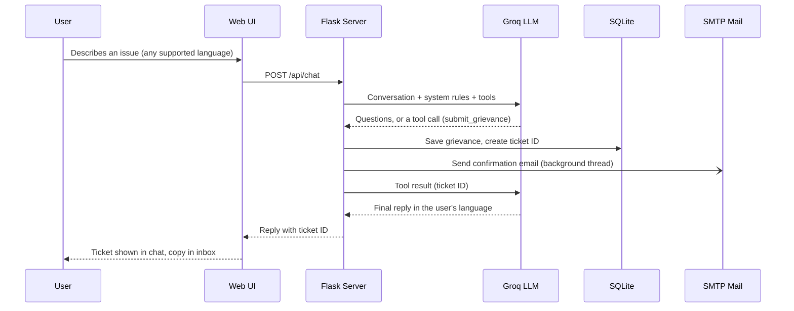

<div align="center">

# Solv

### A multilingual AI grievance assistant for campus communities

Raise a concern in your own language. Get a ticket by email. Track it until it is resolved.

Drive Link: https://drive.google.com/file/d/1cygrJnnjALoRHXUm3Et1EGi9VDoNC6dt/view?usp=sharing


</div>

---

## Overview


Students, staff and parents often hesitate to raise grievances because the process is unclear, slow, or only available in English. **Solv** removes those barriers. It is a conversational assistant that listens in the user's own language, collects the details of a complaint step by step, registers it as a numbered ticket, emails a confirmation, and lets the user check progress at any time. Staff manage everything from a simple dashboard.

Solv is designed for a **single institution**. It is configured with the college name, stores data locally, and keeps the AI key on the server.

## Key Features

| Feature | Description |
|---|---|
| **Multilingual conversation** | English, Telugu, Hindi, Urdu, Tamil and Kannada. Solv replies in the language the user writes in, with right-to-left support for Urdu. |
| **Guided complaint intake** | Collects category, description, location, name, ID, phone and email through natural conversation, then confirms the details before submitting. |
| **Instant ticketing** | Every grievance receives a unique ID in the format `SOLV-2026-0001`. |
| **Ticket emails** | A formatted confirmation is emailed to the complainant automatically over standard SMTP. No extra API or paid service is needed. |
| **Live status tracking** | Users ask for their ticket ID and receive the real status from the database. Solv never guesses a status. |
| **Priority and safety handling** | Harassment, ragging, safety and health matters are marked high priority, and the user is pointed to the Internal Complaints Committee, college authorities or emergency services. |
| **Anonymous filing** | Users may file without sharing name, ID, phone or email. |
| **Voice input** | Speech-to-text in the browser (Chrome and Edge) for the supported languages. |
| **Staff dashboard** | A protected page lists every grievance and lets staff update its status. |
| **Professional interface** | A clean, responsive layout that works on desktop and mobile. |

## How It Works



Solv uses **tool calling**. The language model decides when it has enough information, but only the server writes to the database and sends email. The model can call two tools: `submit_grievance` and `check_status`. This keeps ticket creation reliable and the data trustworthy.

## Tech Stack

- **Backend:** Python, Flask
- **AI:** Groq API (OpenAI-compatible chat completions with tool calling)
- **Database:** SQLite (file-based, no setup)
- **Email:** Python `smtplib` over STARTTLS (works with Gmail App Passwords and any SMTP provider)
- **Frontend:** Vanilla HTML, CSS and JavaScript in a single file, Web Speech API for voice

## Project Structure

```
solv/
├── app.py              Flask server, Groq integration, tools, email, admin page
├── static/
│   └── index.html      Complete user interface
├── requirements.txt    Python dependencies
├── .env.example        Configuration template
├── .env                Your private configuration (never commit this)
└── solv.db             Created automatically on first run
```

## Getting Started

### Prerequisites

- Python 3.10 or newer
- A free Groq API key from [console.groq.com/keys](https://console.groq.com/keys)
- A Gmail account with an App Password (or any SMTP account) for ticket emails

### Installation

```powershell
# 1. Open the project folder
cd solv

# 2. Install dependencies
pip install -r requirements.txt

# 3. Create your configuration file
copy .env.example .env      # macOS/Linux: cp .env.example .env
notepad .env                # fill in the values described below

# 4. Run the application
python app.py
```

Open **http://localhost:5000** in your browser.

### Configuration

All settings live in the `.env` file.

| Variable | Required | Description |
|---|---|---|
| `GROQ_API_KEY` | Yes | Your Groq API key. |
| `GROQ_MODEL` | Yes | A chat model available to your key, for example `openai/gpt-oss-120b`. |
| `COLLEGE_NAME` | No | Institution name shown in the interface and emails. |
| `ADMIN_KEY` | Yes | Password for the staff dashboard. Use a long random value. |
| `SMTP_HOST` | For email | Defaults to `smtp.gmail.com`. |
| `SMTP_PORT` | For email | Defaults to `587`. |
| `SMTP_USER` | For email | The sending email address. |
| `SMTP_PASS` | For email | An App Password, not your normal account password. |

> **Choosing a model.** Groq retires and adds models over time. List the models your key can use, then copy an ID into `GROQ_MODEL`:
>
> ```powershell
> python -c "import os,requests;from dotenv import load_dotenv;load_dotenv();r=requests.get('https://api.groq.com/openai/v1/models',headers={'Authorization':'Bearer '+os.getenv('GROQ_API_KEY')});print('\n'.join(m['id'] for m in r.json()['data']))"
> ```

### Setting Up Ticket Emails (Gmail)

1. Turn on **2-Step Verification** for the sending account.
2. Create an **App Password** at [myaccount.google.com/apppasswords](https://myaccount.google.com/apppasswords).
3. Put the address in `SMTP_USER` and the 16-character password in `SMTP_PASS`.
4. Restart the app and file a test grievance using your own email.

If email is not configured, Solv still works. It tells the user to note the ticket ID from the chat.

## Usage

**For users**

1. Choose a language and start a conversation, or tap **File a grievance**.
2. Answer Solv's questions. Details are read back for confirmation before submission.
3. Receive the ticket ID in the chat and in your inbox.
4. Tap **Track a ticket** and give the ticket ID at any time to see the current status.

**For staff**

Open `http://localhost:5000/admin?key=YOUR_ADMIN_KEY` to view all grievances with category, priority, details, contact information and status. Change a status from the dropdown: `Open`, `In Progress`, `Resolved` or `Closed`.

## Grievance Categories

Academics, Examinations, Hostel, Transport, Canteen, Library, Infrastructure, Fees & Scholarships, Harassment or Ragging, IT & Wi-Fi, and Other.

## API Reference

| Method | Endpoint | Purpose |
|---|---|---|
| `GET` | `/` | Serves the web interface. |
| `GET` | `/api/config` | Returns the institution name. |
| `POST` | `/api/chat` | Accepts `{ messages, lang }` and returns `{ reply }`. |
| `GET` / `POST` | `/admin?key=...` | Staff dashboard and status updates. |

## Security and Privacy

- The Groq API key and SMTP credentials stay on the server and are never sent to the browser.
- Secrets are read from `.env`, which must be excluded from version control.
- All user-supplied text is escaped before it is shown on the staff dashboard.
- Only the last 20 messages of a conversation and 2,000 characters per message are sent to the model.
- Solv is instructed not to invent college policies, and to advise users never to share passwords or OTPs.
- Grievances contain personal details. Restrict access to the server and the database file, and host over HTTPS before real use.

## Limitations and Roadmap

Solv is a working prototype. These are known limits and planned improvements.

- [ ] Replace the single admin key with individual staff accounts and role-based access
- [ ] Route tickets automatically to the responsible department and notify them by email
- [ ] Send the complainant an email whenever the status changes
- [ ] Add analytics for volume, category trends and resolution time
- [ ] Add more languages and a regional-language email template
- [ ] Production deployment with a WSGI server (Gunicorn or Waitress) and HTTPS
- [ ] Optional file or photo attachments as evidence

Free-tier Groq limits and Gmail's daily sending limit (about 500 messages) apply. They are sufficient for a campus pilot.

## Future Scope

The roadmap above covers what the prototype needs to be usable day to day. The ideas below go further and depend on how the pilot goes.

- **Messaging channels.** Let users file and track grievances over WhatsApp or Telegram, so they do not need to open a website.
- **Escalation rules.** Set a response deadline per category. If a ticket sits past it, Solv alerts the next person up the chain automatically.
- **Duplicate and pattern detection.** Group similar complaints, such as ten reports about the same hostel water issue, so staff can fix the cause once instead of closing ten tickets.
- **Spoken replies.** Add text-to-speech so users who cannot read comfortably can hear Solv answer in their own language.
- **Anonymous follow-up.** Give anonymous filers a private tracking code, so they can check progress and answer staff questions without revealing who they are.
- **Staff-side translation.** Show every ticket to staff in English alongside the original text, so a complaint written in Telugu or Urdu can be handled by anyone.
- **Sentiment and urgency signals.** Flag messages that show distress so a person reads them first, instead of relying only on category.
- **Satisfaction feedback.** Ask the user to rate the outcome after a ticket is resolved, and feed those ratings into the analytics.
- **Database upgrade.** Move from SQLite to PostgreSQL once ticket volume or the number of concurrent staff grows.
- **Multi-institution support.** Allow several colleges or departments to run on one deployment, each with its own branding, categories and staff.
- **Mobile app.** Wrap the interface in a lightweight app with push notifications for status changes.

## Troubleshooting

| Symptom | Likely cause and fix |
|---|---|
| `404 Not Found` on the home page | `index.html` must be inside a folder named `static` next to `app.py`. |
| "Solv could not reach the AI service" | Check `GROQ_API_KEY` and `GROQ_MODEL` in `.env`, then restart. The terminal prints a `GROQ ERROR:` line with the reason. |
| `model_not_found` | The model name is wrong or retired. List available models with the command above. |
| Changes to `.env` have no effect | The file is read at startup. Stop the app with Ctrl+C and run it again. |
| Ticket email not received | Check spam or quarantine. Look for `EMAIL ERROR:` in the terminal. Confirm the App Password is correct. |
| Microphone button missing | Voice input needs Chrome or Edge. |

## Team

**Team Starcrusaders**

| Name |
|---|
| Syeda Umima Fatima |
| Jessie Ranvitha Kandikatla |
| Aditi V Jaiswal |

**Institution:** Stanley College of Engineering and Technology for Women, Hyderabad

## Acknowledgements

Built with [Flask](https://flask.palletsprojects.com) and the [Groq](https://groq.com) inference API.

---

<div align="center">

**Solv** &nbsp;|&nbsp; Every concern deserves an answer.

</div>
